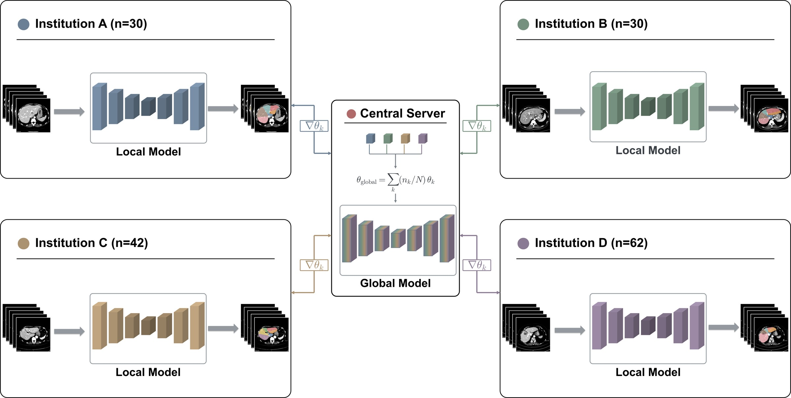

<div align="center">

# Federated Learning for Couinaud Liver Segmentation at CT: A Multicenter Study

[-ffcc4d.svg)](#pretrained-models)
[](LICENSE)
[](https://www.python.org/)
[](https://pytorch.org/)
[](https://flower.ai/)



</div>

---

## Overview

Automated segmentation of the nine Couinaud segments (I, II, III, IVa, IVb, V–VIII) supports lesion localization and future liver remnant (FLR) planning, but single-hospital datasets are small and cannot be pooled. This repository contains the complete code used to train Couinaud segmentation models **with federated learning deployed inside four hospital networks**, where CT images and labels never leave each hospital and only model parameters are exchanged.

**Highlights**

- **Real deployment, not simulation.** Four hospitals trained together behind their own firewalls on heterogeneous hardware (Windows and Linux, x86 and ARM).
- **Four aggregation strategies** compared under identical conditions: FedAvg, FedProx, FedAdam, and FedBN with instance-norm localization (FedBN-IN).
- **Fair comparison with single-hospital training.** Same initialization, architecture, preprocessing, and total training length (100 epochs = 10 rounds × 10 local epochs), with within-hospital 5-fold cross-validation.
- **Open release.** Code, configurations, deployment scripts, and the federated (FedAvg) model weights are released.

## Results

**Within-hospital held-out test (164 patients, 9 segments, patient-level mean Dice)**

| Model | Mean Dice | HD95 (mm) | Δ Dice vs single [95% CI] |
|:--|:--:|:--:|:--:|
| Single-hospital | 0.731 | 20.0 | — |
| FedAdam | 0.750 | 17.2 | +0.019 [−0.006, +0.045] |
| FedProx | 0.756 | 16.8 | +0.024 [+0.001, +0.049] |
| FedBN-IN | 0.766 | 14.8 | +0.035 [+0.018, +0.056] |
| FedAvg | **0.772** | **14.5** | **+0.040 [+0.023, +0.062]** |

FedAvg also reduced patients with mean Dice < 0.5 from 9 to 1.

**External public test set (49 CT scans unseen in training, 8 segments)**

| Model | Dice |
|:--|:--:|
| Single-hospital (A / B / C / D) | 0.638 / 0.689 / 0.699 / 0.671 |
| FedAvg | **0.730** |
| FedProx / FedBN-IN / FedAdam | 0.727 / 0.726 / 0.718 |

All four federated strategies outperformed every hospital's single-site model on the external set (20 of 20 comparisons, Benjamini–Hochberg q ≤ .048). See the paper for full statistics.

## Installation

Requires an NVIDIA GPU (≥24 GB recommended) with a driver supporting **CUDA 12.1 or later**. The installer uses [uv](https://github.com/astral-sh/uv), downloads Python 3.12, and picks the matching PyTorch wheel automatically.

```bash
git clone https://github.com/AISeedHub/CouinaudFL.git
cd CouinaudFL
bash scripts/install.sh          # Windows: scripts\install.bat
```

The last line should read `torch 2.x.x+cuXXX cuda True <GPU name>`.

> Always run scripts with `.venv/bin/python` (Windows: `.venv\Scripts\python`). Do not use `uv sync` or `uv run`, which would replace the CUDA build of PyTorch.

## Data Preparation

One folder per patient, axial CT resampled to 4 mm slices (cranial to caudal):

```
<data_root>/
├── case_0001/
│   ├── image.npy   # uint8 (D, 512, 512), abdominal window (WL 80 / WW 225)
│   └── mask.npy    # uint8 (C, D, 512, 512): ch0 background, ch1–9 = S1 S2 S3 S4a S4b S5 S6 S7 S8
├── case_0002/
└── ...
```

Voxel spacing (for volume and HD95) can be supplied as a CSV or XLSX keyed by folder name; Dice does not depend on it.

## Pretrained Models

| Weights | Count | Description |
|:--|:--:|:--|
| FedAvg (final round) | 5 | One model per cross-validation fold, trained on four hospitals |

Download from **[Hugging Face — link to be added on publication]** or from the [GitHub release](https://github.com/AISeedHub/CouinaudFL/releases/tag/weights-v1.0):

```bash
pip install -U huggingface_hub
huggingface-cli download <org>/<repo> --local-dir weights/
```

All models share the nnU-Net 3d_fullres PlainConvUNet architecture (88.6 M parameters) and were initialized from a common model pretrained on public data (MSD Task08, LiTS, 3D-IRCADb) starting from TotalSegmentator weights.

## Usage

### Evaluate a model

```bash
.venv/bin/python scripts/eval_ours_zero_shot.py \
    --weights <checkpoint.pth> --cases <data_root> --out <output_dir> --no-hd
```

Reports 9-segment and 8-segment (S4a + S4b merged) Dice per case and per segment.

### Single-hospital training

```bash
.venv/bin/python scripts/single.py --config configs/exp4c.yaml --data <data_root> --site A
```

### Federated training

**1. Server.** Set `client_server_address` in the config to your server, then run:

```bash
.venv/bin/python scripts/server.py --config configs/exp4c.yaml --run run_main
```

The server runs every (fold, strategy) session in order, receives results from each site, and exits automatically once all sites have uploaded.

**2. Each hospital.** One command runs the single-hospital 5-fold baseline and then joins all federated sessions, with automatic reconnection and resume:

```bash
bash scripts/run_center_seq.sh <data_root> <site_code> [spacing_file] exp4c
# Windows: scripts\run_center_seq.bat <data_root> <site_code> [spacing_file] exp4c
```

Results are anonymized (patient IDs replaced with `Case N`) before being sent to the server. The ID map stays on the local machine.

### Configuration

Experiments are controlled only through `configs/*.yaml`; the code is fixed.

| Key | Meaning |
|:--|:--|
| `min_clients` | Sites required per round |
| `rounds`, `local_epochs` | Total epochs = rounds × local epochs |
| `methods`, `folds` | Session order (must match on server and clients) |
| `init_weights` | Common initialization |
| `round_timeout_sec` | Maximum wait per round |

## Repository Structure

```
couinaudfl/     core library: data, model, federated strategies, inference
scripts/        training, federated server/client, evaluation, export
configs/        experiment configurations
```

## Citation

```bibtex
@article{couinaudfl2026,
  title   = {Federated Learning for Couinaud Liver Segmentation at CT: A Multicenter Study},
  author  = {TBA},
  journal = {Radiology: Artificial Intelligence},
  year    = {2026},
  note    = {Submitted}
}
```

## License

- **Code:** [Apache License 2.0](LICENSE).
- **Model weights:** released on Hugging Face under separate terms stated in the model card, reflecting the licenses of the public training data and the initialization weights. Research use only.

## Acknowledgments

This work builds on [nnU-Net](https://github.com/MIC-DKFZ/nnUNet), [TotalSegmentator](https://github.com/wasserth/TotalSegmentator), and [Flower](https://flower.ai/). Anthropic Claude (Claude Code) was used as an assistant for code writing, refactoring, and verification; study design, data handling, interpretation, and final verification were performed by the authors.
